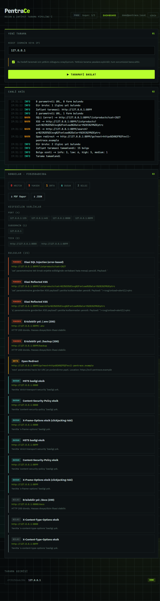
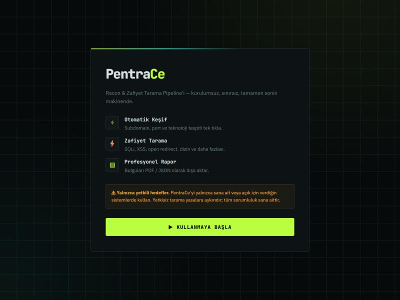
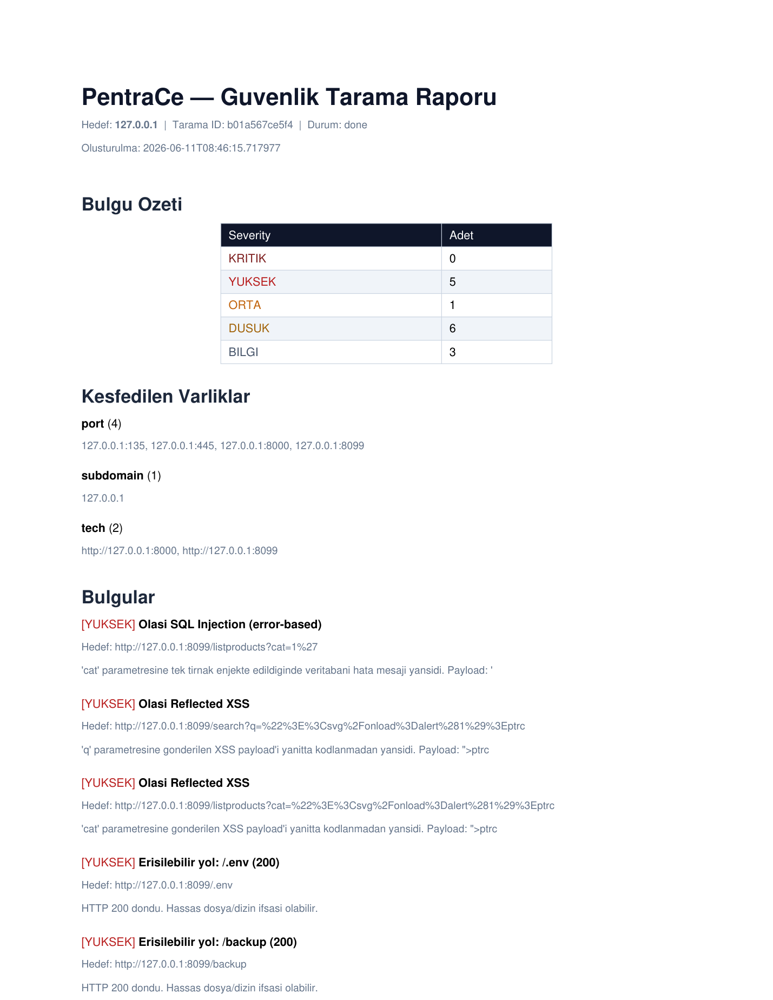

# PentraCe — Otomatik Recon &amp; Zafiyet Tarama

[](LICENSE)


> Bir hedef gir → otomatik keşif → zafiyet tarama → canlı dashboard + PDF rapor.

PentraCe, kurulumsuz ve sunucusuz çalışan bir masaüstü güvenlik tarama aracıdır.
Tek `.exe` indirilir, çift tıklanır ve kullanılır — üyelik, login ya da abonelik yok.
Bütün tarama kullanıcının kendi makinesinde koşar; hiçbir veri dışarı gönderilmez.



---

## ⚠️ Etik ve Yasal Uyarı

PentraCe'yi **yalnızca sana ait olan veya açık yazılı izin aldığın** sistemlerde kullan.
Yetkisiz tarama çoğu ülkede suçtur ve sorumluluk tümüyle kullanıcıya aittir. Bu proje
eğitim ve yetkili güvenlik testleri için yazıldı.

---

## Ekran Görüntüleri

| Karşılama ekranı | PDF rapor çıktısı |
|:---:|:---:|
|  |  |
| İlk açılışta gösterilen, login gerektirmeyen giriş ekranı. | Her taramanın PDF ve JSON olarak dışa aktarılabilen raporu. |

Ana dashboard yukarıdaki hero görselinde: hedef girişi, Server-Sent Events ile akan
canlı log ve önem derecesine göre gruplanmış bulgu kartları tek ekranda.

---

## Ne yapar

| Aşama | İçerik |
|-------|--------|
| **Recon** | Subdomain keşfi (crt.sh + wordlist), `asyncio` port tarama, HTTP başlık &amp; teknoloji parmak izi |
| **Zafiyet Tarama** | SQL injection, XSS, open redirect, dizin bruteforce, SSRF, eksik güvenlik başlıkları |
| **Harici Araçlar** | İsteğe bağlı ProjectDiscovery entegrasyonu — `subfinder`, `naabu`, `nuclei` otomatik tespit edilir; yoksa yerleşik kontrole geri döner |
| **Dashboard** | Canlı log akışı, severity grafiği, önem derecesine göre bulgu kartları |
| **Rapor** | Skorlanmış bulgular → PDF / JSON dışa aktarma |

Port tarama saf `asyncio` ile yapılır, harici `nmap` gerektirmez. ProjectDiscovery
araçları kurulu değilse resmi GitHub release'inden indirilir ve SHA256 ile doğrulanır;
indirme kapalıysa tarama yerleşik kontrollerle devam eder.

---

## Nasıl çalışır

```
  Hedef (domain / IP)
        │
        ▼
  ┌─────────────┐   subdomain · port · fingerprint
  │   RECON     │   (crt.sh, asyncio, subfinder/naabu)
  └─────┬───────┘
        ▼
  ┌─────────────┐   SQLi · XSS · redirect · dir-brute
  │  VULNSCAN   │   · SSRF · headers · nuclei
  └─────┬───────┘
        ▼
  ┌─────────────┐   SQLite kayıt + SSE canlı akış
  │  PIPELINE   │   (async orchestrator)
  └─────┬───────┘
        ▼
  Dashboard  +  PDF / JSON rapor
```

Backend `pipeline.py` içinde bir async orchestrator olarak çalışır: recon çıktısını
vulnscan'e besler, her adımı SQLite'a yazar ve aynı anda Server-Sent Events üzerinden
arayüze canlı olarak akıtır.

---

## Teknoloji Yığını

| Katman | Kullanılan |
|--------|-----------|
| **Backend** | Python 3.12, FastAPI, SQLAlchemy (async) + SQLite, `httpx`, BeautifulSoup |
| **Frontend** | React 18, Vite 6 (framework'süz, hafif) |
| **Rapor** | ReportLab (PDF) |
| **Masaüstü** | PyWebView + WebView2, tek dosya paketleme için PyInstaller |
| **Harici araçlar** | ProjectDiscovery `subfinder` · `naabu` · `nuclei` (opsiyonel) |

Backend, arayüz ve SQLite tek bir `.exe` içinde paketlenir ve Windows'un yerleşik
WebView2 bileşeninde native bir pencerede açılır.

---

## Kurulum

**İndir, çift tıkla:** derlenmiş `PentraCe.exe`'yi çalıştırman yeterli. Kurulum
sihirbazı yok — aç, karşılama ekranını geç, kullan. Bütün veri `%APPDATA%\PentraCe`
altında tutulur (SQLite veritabanı + raporlar).

> İmzasız bir `.exe` olduğu için Windows SmartScreen uyarısı verebilir:
> *Daha fazla bilgi → Yine de çalıştır*.

---

## Geliştirme

```powershell
# Backend (Python 3.12)
cd backend
py -3.12 -m venv .venv
.\.venv\Scripts\python.exe -m pip install -r requirements.txt

# Masaüstü uygulamasını paketlemeden çalıştır:
.\.venv\Scripts\python.exe desktop.py

# Veya web modunda geliştir (anlık yenileme):
.\.venv\Scripts\python.exe -m uvicorn main:app --port 8000   # 1. pencere
cd ..\frontend; npm install; npm run dev                      # 2. pencere → http://localhost:5173
```

### `.exe` build

```powershell
.\build-desktop.ps1            # üretim (penceresiz)
# .\build-desktop.ps1 -Console # hata ayıklama (konsollu)
```

Çıktı: **`backend/dist/PentraCe.exe`**.

---

## Proje Yapısı

```
pentrace/
├── build-desktop.ps1       # tek komut .exe build
├── backend/
│   ├── desktop.py          # masaüstü launcher (PyWebView + uvicorn thread)
│   ├── main.py             # FastAPI: scan CRUD + SSE + rapor + statik servis
│   ├── pipeline.py         # async orchestrator (recon → vulnscan → DB)
│   ├── models.py           # ORM (Scan/Asset/Finding) + repository
│   ├── report.py           # PDF + JSON rapor
│   ├── db.py · config.py · paths.py
│   ├── modules/
│   │   ├── recon.py        # subdomain, port, fingerprint
│   │   ├── vulnscan.py     # SQLi, XSS, redirect, dir-brute, SSRF, headers
│   │   └── tools/          # ProjectDiscovery adapter'ları (subfinder/naabu/nuclei)
│   ├── wordlists/
│   └── tests/
└── frontend/
    └── src/
        ├── App.jsx         # welcome → dashboard
        ├── Welcome.jsx     # ilk açılış ekranı
        ├── Dashboard.jsx   # tarama + canlı akış + sonuçlar
        ├── ResultsViz.jsx  # severity grafiği + özet
        ├── api.js · main.jsx · styles.css
```

---

## Lisans

MIT — bkz. [LICENSE](LICENSE). Yalnızca yetkili güvenlik testleri için kullanın.
